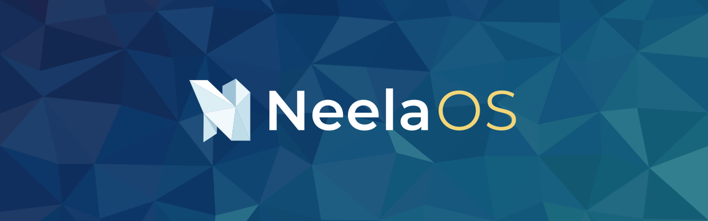
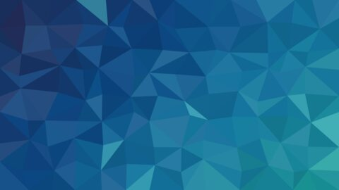
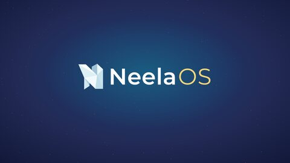

<p align="center">
  
</p>

<p align="center"><i>OS, for the love of wind</i></p>

<p align="center">
  <b>A free Windows-familiar Linux desktop for Computer Science students,<br>
  with every coding tool ready from the very first boot.</b>
</p>

<p align="center">
  
  
  
  
</p>

<p align="center">
  <a href="#-install-neelaos">Install</a> ·
  <a href="#-whats-inside">What's inside</a> ·
  <a href="#-wallpapers">Wallpapers</a> ·
  <a href="#-staying-up-to-date">Updates</a> ·
  <a href="#-good-to-know">Good to know</a> ·
  <a href="#-for-developers">For developers</a>
</p>

---

## 💡 Why NeelaOS?

Most students learn to code on Windows, then spend their first weeks fighting setup: compilers,
paths, missing tools. NeelaOS skips all that. It **looks and works like Windows** (taskbar,
Start menu, familiar shortcuts, double-click to open) and comes with **everything a CS course
needs already installed**, on top of the speed and stability of Linux.

<table>
<tr>
<td width="50%" valign="top">

### 😯 Feels like Windows

Start button, taskbar, desktop icons, `Win` key shortcuts, a Files app laid out like
File Explorer, and apps with plain names: Files, Terminal, Notepad, Task Manager.

</td>
<td width="50%" valign="top">

### 💻 Ready to code

C/C++, Python, Java, Node.js, Git, VS Code with the right extensions, Docker-compatible
Podman, and Ubuntu-style **`sudo apt install`** that just works.

</td>
</tr>
<tr>
<td width="50%" valign="top">

### 🛡️ Safe to experiment

Automatic **restore points** before every update and once a day, like Windows System
Restore. Broke something? Roll back in two clicks.

</td>
<td width="50%" valign="top">

### 🎨 Made to look good

Navy, teal and gold Neela Dark and Neela Light themes, six original wallpapers, a NeelaOS
boot splash, login screen and the _Digital Dawn_ startup sound.

</td>
</tr>
</table>

Under the hood NeelaOS is a **Fedora Remix**: Fedora's packages and security updates, with
NeelaOS's own look, apps, setup and defaults on top. Everything is free.

---

## 💥 Install NeelaOS

<details>
<summary><b>Download and Configure your own Machine</b></summary>

**Requirements:** a 64-bit PC (Intel or AMD) with **4 GB RAM** (8 GB recommended), **40 GB** of
free disk space, a **USB stick of 8 GB+** (it will be erased), and internet for the first login.

1. **Download** `NeelaOS-x86_64.iso` and `NeelaOS-x86_64.iso.sha256`, then check the download:
   - Windows (PowerShell): `Get-FileHash NeelaOS-x86_64.iso` and compare it with the `.sha256` file
   - Linux: `sha256sum -c NeelaOS-x86_64.iso.sha256`
2. **Write it to the USB stick** with **Rufus** (choose _DD image mode_ when asked),
   **Fedora Media Writer** or **balenaEtcher**.
3. **Boot from the USB:** restart, open the boot menu (usually `F12`, `F11`, `F9`, `Esc` or `F2`),
   pick the USB stick, then **Start NeelaOS**.
4. **Try it, then install it:** NeelaOS runs from the USB without changing your PC. Click
   **Install NeelaOS** and **Neela Setup** asks for your language, keyboard, disk and account.
   - _Use the whole disk_ (wipes it), or _install alongside Windows_ to keep both.
   - Keep the default **Btrfs** layout to get restore points.
   - Want a separate "D: drive" for your files? Choose custom partitioning and add a `/home` partition.
5. **Restart, remove the USB and log in.** Stay online for 10–20 minutes while the **Welcome**
   app finishes setting up VS Code, Brave and media codecs in the background.

Secure Boot works out of the box (NeelaOS uses Fedora's signed boot chain).

</details>

<details>
<summary><i>Try it in VirtualBox first</i></summary>

New VM → Type **Linux**, Version **Fedora (64-bit)** (_not_ "Other": that makes a 32-bit VM and
the kernel refuses to start). Then:

- **Enable EFI**
- 4–6 GB memory and 2–4 CPUs
- A **40 GB** disk (smaller disks fail the installer's space check)
- Display → **VMSVGA**, 128 MB

Attach the ISO and start. After installing, remove the ISO (Settings → Storage) and restart.

</details>

---

## 📦 What's inside

### Feels like Windows

- Taskbar with a **Start button** (the NeelaOS logo), pinned apps, system tray and clock
- Desktop icons, double-click to open, minimize / maximize / close on the right, a white cursor
- **Files** laid out like File Explorer: menu bar, Back / Forward / Up, address bar, refresh and
  search, and one sidebar with **Quick access**, **Network** and **This PC**. Thumbnails for
  videos, PDFs and documents, zip files that open like folders, right-click **Open Terminal Here**
- Apps with plain names: **Files, Terminal, Settings, Task Manager, Snipping Tool, Photos,
  Notepad, Calculator, NeelaPDF, NeelaZip, NeelaConnect, NeelaDiary, Neela PC, Neela Store**

<details>
<summary><b>Keyboard shortcuts you already know</b></summary>

| Shortcut             | Does                             |
| -------------------- | -------------------------------- |
| `Win`                | Start menu (just type to search) |
| `Win + E`            | Files                            |
| `Win + L`            | Lock the screen                  |
| `Win + D`            | Show the desktop                 |
| `Win + ← / →`        | Snap a window to half the screen |
| `Win + V`            | Clipboard history                |
| `Win + Shift + S`    | Screenshot of an area            |
| `Win + .`            | Emoji                            |
| `Ctrl + Shift + Esc` | Task Manager                     |
| `Ctrl + Alt + T`     | Terminal                         |

</details>

### Ready for coding on day one

|                |                                                                                                                                                 |
| -------------- | ----------------------------------------------------------------------------------------------------------------------------------------------- |
| **Languages**  | C / C++ (gcc, g++, gdb, Valgrind, CMake, make), Python + pip, Java (OpenJDK), Node.js + npm, SQLite                                             |
| **Editor**     | VS Code with C/C++, Python, Java, Jupyter, web, formatter, theme and icon extensions, in NeelaOS colors                                         |
| **Git**        | Git, plus **[rgit](https://github.com/ettisafxrup/rgit)**: `rgit push "message"`, `rgit pull`, `rgit status`, `rgit undo`                       |
| **Packages**   | Ubuntu-style **`sudo apt install / update / upgrade / remove / search`**, which also understands Ubuntu package names like `build-essential`    |
| **Containers** | Podman, which works with Docker commands                                                                                                        |
| **Terminal**   | Git-aware prompt, `tldr` for quick command examples, ready-made C, C++, Python, Java, HTML and Markdown templates in right-click → _Create New_ |

**Dev packs:** one click in the Welcome app adds what your courses need: Web Development,
Data Science & AI, Competitive Programming, Go & Rust, Operating Systems & VMs, Networking &
Security, Android Development, Graphics & Recording, Classes & Chat, Gaming, Run Windows Programs.

### Everyday apps

- **Brave** as the default browser, with a NeelaOS start page (search, how-tos, terminal cheat sheet, study links)
- **Thunderbird** for mail, and **LibreOffice** with a Microsoft Office-style ribbon that saves
  `.docx` / `.xlsx` / `.pptx` by default
- Fonts that match Calibri, Cambria, Arial, Times New Roman and Courier New letter for letter,
  so Office documents keep their layout
- Music, Videos, Photos, Camera, Paint, Scanner, NeelaConnect (phone link) and HP printer drivers

### Safe and easy to look after

- **Restore points** before every update and once a day; roll back with the **Restore Points** app
  without touching your personal files
- **NVIDIA** drivers set up automatically, or with a guided `neelaos-nvidia-setup` when Secure Boot is on
- **Updates** for Fedora, NeelaOS, Brave and VS Code in one place (see below)

---

## 🖼️ Wallpapers

<table>
<tr>
<td align="center"><br><sub><b>Crystal</b> (default)</sub></td>
<td align="center"><br><sub><b>Marble</b></sub></td>
<td align="center"><br><sub><b>Waves</b></sub></td>
</tr>
<tr>
<td align="center"><br><sub><b>Aurora</b></sub></td>
<td align="center"><br><sub><b>Dusk</b></sub></td>
<td align="center"><br><sub><b>Signature</b></sub></td>
</tr>
</table>

Colors: navy `#222B56` · blue `#0B4683` · teal `#1A9695` · gold `#D69510` · light gold `#F2D678`.
Switch between **Neela Dark** and **Neela Light** in the Welcome app; VS Code follows.

---

## 🔄 Staying up to date

Fedora's updates and NeelaOS's own improvements arrive together. Install them from
**Neela Store → Updates**, or in the Terminal:

```bash
sudo apt update && sudo apt upgrade
```

A restore point is taken before every update, so you can always go back.

---

## 📝 Good to know

- **Windows-only apps** (Microsoft Office desktop, Adobe, games with anti-cheat) don't run.
  Use LibreOffice or Office in the browser. Many Windows games work through Steam's Proton, and
  the _Run Windows Programs_ dev pack runs many simple `.exe` programs.
- **Ubuntu `.deb` files** can't be installed. Use Neela Store (Flatpak) or the app's `.rpm` version.
- **Brave is installed on first boot**, so the live USB has no visible browser.
- In the Terminal, copy and paste are `Ctrl + Shift + C` / `Ctrl + Shift + V`
  (`Ctrl + C` stops the running program, as in every Linux terminal).
- First-boot setup writes its log to `/var/log/neelaos-firstboot.log`.

---

## 📂 Credits

- Built on **[Fedora](https://fedoraproject.org)** and **[KDE Plasma](https://kde.org/plasma-desktop/)**.
  NeelaOS is a Fedora Remix and is not affiliated with or endorsed by the Fedora Project.
- **[rgit](https://github.com/ettisafxrup/rgit)** by Ettisaf Rup (same author of NeelaOs)
- Fonts: **Montserrat** and **Space Grotesk** (SIL Open Font License)

<p align="center"><sub>Made with 💙 for the love of wind.</sub></p>
